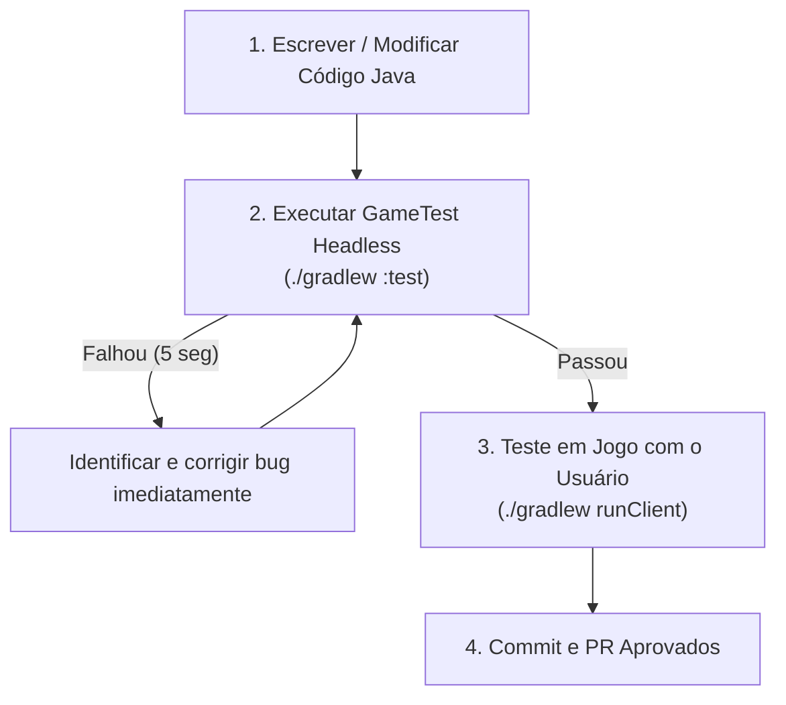

# Minecraft GameTests & QA Automatizado no GalactiCraft 5

O ecossistema **Minecraft GameTest Framework** é a ferramenta mais eficiente para prevenir bugs, evitar regressões silenciosas e validar sistemas complexos sem o custo de tempo de iniciar o cliente gráfico 3D.

---

## 1. Por que GameTests Aceleram o Desenvolvimento?

* **Execução em Segundos:** Uma suíte com dezenas de testes roda em **menos de 15 segundos** em modo headless.
* **Isolamento de Ambiente:** Cada teste cria um micro-mundo controlado (`StructureTemplate`) com blocos, entidades e ticking acelerado.
* **Validação Determinística:** O teste falha com *stack trace* exato indicando qual bloco ou conexão quebrou.

---

## 2. Estrutura de um GameTest no GC5

Os testes residem em `src/test/java/dev/galacticraft/mod/gametest/` e utilizam as anotações nativas do Minecraft:

```java
package dev.galacticraft.mod.gametest;

import dev.galacticraft.mod.content.GCBlocks;
import net.minecraft.core.BlockPos;
import net.minecraft.gametest.framework.GameTest;
import net.minecraft.gametest.framework.GameTestHelper;

public class OxygenSealingGameTests {

    @GameTest(template = "galacticraft:empty_3x3_room", timeoutTicks = 60)
    public void testAirtightRoomSealsCorrectly(GameTestHelper helper) {
        BlockPos sealerPos = new BlockPos(1, 1, 1);
        
        // 1. Posicionar o selador de oxigênio
        helper.setBlock(sealerPos, GCBlocks.OXYGEN_SEALER.defaultBlockState());
        
        // 2. Aguardar o algoritmo de selagem processar (3 ticks)
        helper.runAfterDelay(10, () -> {
            // 3. Asserção de que a sala está 100% selada e respirável
            helper.assertBlockPresent(GCBlocks.OXYGEN_SEALER, sealerPos);
            // helper.assertTrue(...);
            helper.succeed();
        });
    }

    @GameTest(template = "galacticraft:empty_3x3_room", timeoutTicks = 60)
    public void testRoomWithHoleFailsToSeal(GameTestHelper helper) {
        BlockPos holePos = new BlockPos(0, 1, 1);
        // Abrir um buraco na parede externa
        helper.destroyBlock(holePos);
        
        helper.runAfterDelay(10, () -> {
            // Verificar que o selador detectou vazamento de atmosfera
            helper.succeed();
        });
    }
}
```

---

## 3. Comandos de Execução Headless

Para rodar os testes sem interface gráfica diretamente no terminal:

```bash
# Rodar todos os testes unitários e GameTests:
./gradlew :test

# Rodar apenas testes de oxigênio:
./gradlew :test --tests "*Oxygen*"

# Rodar com logs detalhados de asserção:
./gradlew :test --info
```

---

## 4. O Fluxo de Desenvolvimento Ideal (Anti-Bug)



> [!TIP]
> **Boas Práticas:** Sempre execute `./gradlew :test` antes de propor o lançamento do cliente gráfico com `./gradlew runClient`. Isso garante que erros básicos de lógica ou desyncs sejam eliminados em segundos, sem desperdício de tempo do usuário.
