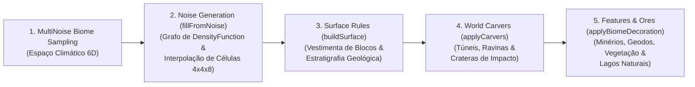

# Engenharia e Otimização de Geração Procedural de Mundo no Minecraft 1.21+

Este documento é a referência técnica definitiva e o guia de engenharia consolidado para geração procedural de terrenos planetários, relevos contínuos e sistemas subterrâneos no Minecraft 1.21+ (Fabric Loom / Galacticraft).

O guia está rigorosamente estruturado em duas partes:
* **PARTE I — Arquitetura e Engenharia Universal de Worldgen:** Padrões matemáticos, diretrizes de performance, armadilhas do motor da Mojang e boas práticas aplicáveis a **qualquer dimensão ou corpo celeste** (Lua, Marte, Vênus, Asteroides, luas alienígenas, etc.).
* **PARTE II — Estudo de Caso de Implementação: O Planeta Mercúrio:** Detalhamento prático de parâmetros, estratigrafia, biomas temáticos e materiais específicos utilizados como prova de conceito em Mercúrio.

---

# PARTE I: Arquitetura e Engenharia Universal (Agnóstico a Planetas)

---

## 1. Pipeline de Worldgen e o Budget de Performance

No Minecraft 1.21+, a geração de cada chunk é processada em estágios concorrentes através de `CompletableFuture` no worker pool de threads da CPU:



### O Budget de Performance Crítico
* **Meta Estrita:** O ciclo completo de geração deve executar em **menos de 50 ms** em média por chunk, com $p95 \le 60\text{ ms}$ (mesmo durante voo criativo de alta velocidade ou teleporte de foguetes).
* **Distribuição Saudável de Carga:**
  * `fillFromNoise`: $\approx 20 - 30\text{ ms}$ (máximo 60% do budget).
  * `buildSurface`: $\approx 2 - 5\text{ ms}$.
  * `applyCarvers`: $\approx 2 - 6\text{ ms}$.
  * `applyBiomeDecoration`: $\approx 5 - 12\text{ ms}$.

---

## 2. Otimização Extrema de `DensityFunction`

O gargalo de 95% do tempo de geração reside em `NoiseBasedChunkGenerator.fillFromNoise()` / `NoiseChunk.doFill()`. As técnicas universais abaixo são mandatórias para qualquer dimensão:

### 2.1. Interpolação Trilinear em Células 4x4x8 (`DensityFunctions.interpolated`)

#### O Mecanismo
O motor particiona o chunk ($16 \times 16 \times \text{altura}$) em células de $4 \times 4 \times 8$ blocos ($4$ em X, $4$ em Z, $8$ em Y):
* **Sem Interpolação:** A função de densidade é calculada bloco a bloco ($16 \times 16 \times 256 = 65.536$ avaliações completas do grafo trigonométrico por chunk).
* **Com `DensityFunctions.interpolated(...)`:** A densidade é avaliada apenas nos **8 vértices dos cantos da célula** (reduzindo as chamadas pesadas para ~825 por chunk). Os blocos internos são preenchidos por interpolação trilinear vetorial de baixíssimo custo de hardware.

> [!IMPORTANT]
> **Regra Universal:** Toda base de ruído 3D Perlin/Simplex que varia no espaço (cavernas cheese, noodle tunnels, pilares, magma e rugosidade 3D) DEVE ser encapsulada em `DensityFunctions.interpolated(...)` ou ser calculada a partir de coordenadas interpoladas.

---

### 2.2. A Armadilha Fatal do Fatiador de Pão ("Bread-Slicer Bug")

#### O Sintoma
O mundo gera fatiado em dezenas de lâminas verticais paralelas alinhadas aos eixos cardeais, separadas por fendas vazias contínuas que cortam continentes inteiros.

#### A Causa Raiz
O `NoiseInterpolator` gerencia internamente contadores de passo (`stepX`, `stepY`, `stepZ`). Se a função raiz `final_density` for encapsulada em `DensityFunctions.interpolated(...)` e internamente consultar outras subfunções também interpoladas, as chamadas recursivas resetam o estado do interpolador pai a cada voxel. O passo de interpolação no eixo X ou Z congela em `0.0`, colapsando o espaço 3D em fatias bidimensionais.

#### O Padrão Canônico Universal
```java
// ❌ PROIBIDO - Causa o fatiamento paralelo do mundo:
context.register(FINAL_DENSITY, DensityFunctions.interpolated(finalDensity));

// ✅ PADRÃO CORRETO (Universal):
// Apenas sub-funções 3D individuais recebem DensityFunctions.interpolated(...).
// O finalDensity é passado diretamente pelo NoiseRouter através do blendDensity:
return new NoiseRouter(
        barrierNoise,
        fluidLevelFloodednessNoise,
        fluidLevelSpreadNoise,
        lavaNoise,
        temperature,
        vegetation,
        continents,
        erosion,
        depth,
        ridges,
        planetSolidTerrain,                        // initialDensityWithoutJaggedness (crosta sólida pura)
        DensityFunctions.blendDensity(finalDensity), // finalDensity (sem wrapper interpolated externo!)
        ...
);
```

---

### 2.3. Poda por Intervalo (`DensityFunctions.rangeChoice` Culling)

Avaliar múltiplos sistemas de cavernas 3D complexos em alturas onde cavernas não existem consome milhões de ciclos de CPU inúteis. A técnica de poda por `rangeChoice` descarta ramos do grafo de nós antes do cálculo:

```java
// 1. Poda de Altitude (Altitude Culling):
// Acima de certa cota do relevo, cavernas não existem no topo montanhoso.
// O motor avalia o ruído linear base e desvia IMEDIATAMENTE para Zero!
DensityFunction altitudeCaves = DensityFunctions.rangeChoice(
        planetBaseHeight,
        minCaveHeightThreshold, maxCaveHeightThreshold,
        boundedCaveCarve,
        DensityFunctions.zero()
);

// 2. Poda de Céu Aberto (Open Sky Culling):
// No ar rarefeito alto acima da superfície sólida, ignora avaliação de cavernas.
DensityFunction activeCaves = DensityFunctions.rangeChoice(
        planetSolidTerrain,
        -0.70, 10.0,
        altitudeCaves,
        DensityFunctions.zero()
);

// 3. Poda de Pilares por Cavidade Aberta (Pillar Cavity Culling):
// Pilares só precisam ser calculados onde uma caverna EFETIVAMENTE abriu um vazio (activeCaves < -0.05).
// Em 90% do volume do mundo (rocha maciça sólida ou ar livre), o ruído de pilares é descartado com custo zero!
DensityFunction activePillars = DensityFunctions.rangeChoice(
        activeCaves,
        -1000.0, -0.05,
        clampedPillars,
        DensityFunctions.constant(-1000000.0)
);
```

---

### 2.4. Estratégia de Caching Universal: `flatCache`, `cache2d` e `cacheOnce`

A escolha correta do tipo de cache no grafo de densidade determina a diferença entre um mundo fluido a 20 ms/chunk ou um congelamento catastrófico a 900+ ms/chunk:

* **`DensityFunctions.cache2d(...)` (Canônico para Relevo e Splines):**
  Avalia a função com **resolução horizontal precisa de 1x1 bloco** (bloco a bloco, sem aproximação por grade) e **armazena o resultado para toda a coluna vertical $Y$**.
  * **Vantagem Visual:** Elimina 100% dos degraus ortogonais de 4x4 blocos ("staircases" de 90°).
  * **Vantagem de Performance:** Em vez de avaliar a spline $16 \times 16 \times 288 = 73.728$ vezes por chunk, avalia apenas $16 \times 16 \times 1 = 256$ vezes. **Elimina 97,3% das chamadas Perlin**, reduzindo o tempo de CPU de ~890 ms para ~15 ms!
  * **Onde Usar:** SEMPRE em coordenadas de deslocamento (`shiftX`, `shiftZ`), continentalidade 2D (`continents`), splines de elevação (`offset`), amplitude (`factor`) e relevo suave 2D (`smooth_relief`).

* **`DensityFunctions.flatCache(...)` (Cuidado: Apenas para Parâmetros Macro):**
  Avalia uma coordenada ou ruído 2D apenas **uma vez por célula de 4x4 blocos** (independente da altura $Y$).
  * **⚠️ Perigo ("The FlatCache Trap"):** Se aplicado a splines de elevação íngremes, produz cortes ortogonais retos de 90° e degraus de 4 em 4 blocos. **NUNCA use `flatCache` diretamente em splines de relevo de terreno**. Use estritamente para parâmetros bioclimáticos de transição lenta (temperatura, vegetação) ou grids de raridade de pilares.

* **`DensityFunctions.cacheOnce(...)`:**
  Armazena o resultado de uma subexpressão complexa caso ela seja consultada mais de uma vez na mesma coordenada tridimensional $(x, y, z)$ dentro do mesmo ciclo de voxel.

---

### 2.5. Segregação Mandatória de Coordenadas de Spline entre Dimensões

Ao construir splines de relevo (`CubicSpline.builder(...)`), a coordenada independente (`DensityFunctions.Spline.Coordinate`) representa o eixo horizontal de entrada (geralmente Continentalidade ou Erosão).

> [!CAUTION]
> **A Armadilha do Compartilhamento Global de Coordenadas:**
> Se uma dimensão criar sua própria função customizada de continentalidade (como `Moon.CONTINENTS`) e atribuir essa função à variável compartilhada `continentsCoord`, **todas as outras dimensões do mod (como Marte e Vênus) que utilizam `continentsCoord` serão acopladas à geração da Lua!**
> Isso destrói os biomas de Marte e Vênus, pois suas splines passam a amostrar a continentalidade lunar em vez da continentalidade vanilla ou nativa.

#### Regra Canônica de Segregação
Declare e isole explicitamente as coordenadas de cada dimensão no `GCDensityFunctions.bootstrapRegistries`:
```java
// Coordenada exclusiva da Lua (baseada em Moon.CONTINENTS com cache2d):
var moonContinentsCoord = new DensityFunctions.Spline.Coordinate(
        context.lookup(Registries.DENSITY_FUNCTION).getOrThrow(Moon.CONTINENTS)
);

// Coordenada padrão Vanilla / Multi-Planetas (baseada em NoiseRouterData.CONTINENTS):
var vanillaContinentsCoord = new DensityFunctions.Spline.Coordinate(
        vanillaRegistry.getOrThrow(NoiseRouterData.CONTINENTS)
);

// A Lua usa estritamente moonContinentsCoord:
var moonOffsetSpline = CubicSpline.builder(moonContinentsCoord)...

// Marte e Vênus usam estritamente vanillaContinentsCoord:
var marsOffsetSpline = CubicSpline.builder(vanillaContinentsCoord)...
var venusOffsetSpline = CubicSpline.builder(vanillaContinentsCoord)...
```

---

## 3. Relevo Contínuo de Alta Performance vs A Armadilha do Caching Duplo

### O Dilema Clássico de Worldgen: Degraus de 90° vs Gargalo de 900 ms
1. **O Erro do `flatCache`:** Envolver splines de elevação em `flatCache` cria degraus ortogonais retos de 90° ("escadarias maias") a cada 4 blocos nas montanhas e bordas de crateras.
2. **O Erro do "Sem Cache":** Remover completamente o cache faz com que o grafo trigonométrico seja recalculado para todos os 73.728 voxels do chunk. O tempo de cálculo da fase `noise` salta para **890 ms a 1.500 ms**, paralisando o servidor e o cliente.

### A Solução Canônica da Engenharia Aeronáutica (O Triângulo de Ouro):
1. **Deslocamento e Continentalidade com `cache2d` (Resolução de 1 Bloco):**
   ```java
   DensityFunction moonShiftX = DensityFunctions.cache2d(
           DensityFunctions.noise(noiseRegistry.getOrThrow(Noises.SHIFT), 0.25, 0.0)
   );
   DensityFunction moonShiftZ = DensityFunctions.cache2d(
           DensityFunctions.noise(noiseRegistry.getOrThrow(Noises.SHIFT), 0.0, 0.25)
   );
   DensityFunction moonContinents = registerAndWrap(context, Moon.CONTINENTS,
           DensityFunctions.cache2d(
                   DensityFunctions.shiftedNoise2d(moonShiftX, moonShiftZ, 0.25, noiseRegistry.getOrThrow(Noises.CONTINENTALNESS))
           )
   );
   ```

2. **Splines e Relevo 2D Envelopados com `cache2d`:**
   ```java
   DensityFunction moonOffset = registerAndWrap(context, Moon.OFFSET, DensityFunctions.cache2d(DensityFunctions.spline(moonOffsetSpline)));
   DensityFunction moonFactor = registerAndWrap(context, Moon.FACTOR, DensityFunctions.cache2d(DensityFunctions.spline(moonFactorSpline)));
   DensityFunction moonSmoothRelief = registerAndWrap(context, Moon.SMOOTH_RELIEF, DensityFunctions.cache2d(
           DensityFunctions.mul(moonFactor, combinedReliefNoises)
   ));
   ```

3. **Fusão com Rugosidade 3D (`BlendedNoise`) e Interpolação por Célula:**
   O ruído volumétrico 3D (que dá textura rochosa e escarpas naturais) DEVE ser somado ao relevo base dentro de `SOLID_TERRAIN` e envelopado por `DensityFunctions.interpolated(...)`. Isso reduz as avaliações do ruído 3D de 73.728 voxels para apenas **825 vértices de célula**:
   ```java
   DensityFunction moonRaw3dRoughness = DensityFunctions.mul(
           moonFactor,
           DensityFunctions.mul(
                   DensityFunctions.constant(0.12),
                   BlendedNoise.createUnseeded(0.25, 0.125, 80.0, 160.0, 8.0)
           )
   );

   DensityFunction moonRawSolidTerrain = DensityFunctions.add(
           moonBaseHeight,
           DensityFunctions.add(moonOffset, DensityFunctions.add(moonSmoothRelief, moonRaw3dRoughness))
   );

   // Interpolação trilinear por células 4x4x8:
   DensityFunction moonInterpolatedSolidTerrain = registerAndWrap(
           context,
           Moon.SOLID_TERRAIN,
           DensityFunctions.interpolated(moonRawSolidTerrain)
   );

   // FINAL_DENSITY é uma composição escalar SEM outer interpolated:
   context.register(Moon.FINAL_DENSITY, DensityFunctions.min(
           moonInterpolatedSolidTerrain,
           noodles
   ));
   ```

---

## 4. Cavernas Monumentais sem Rompimento de Superfície nem Contaminação de Piso

### 4.1. Blindagem Dinâmica da Crosta (`surfaceCeilingTaper`)
Em relevos dinâmicos com depressões e picos elevados, fixar uma altura de teto estática via `yClampedGradient` rompe a superfície nas bacias ou sela as montanhas.
Calcule a blindagem ancorada na crosta local:
```java
DensityFunction localSurface = DensityFunctions.add(planetBaseHeight, planetOffset);
DensityFunction surfaceCeilingTaper = DensityFunctions.add(
        DensityFunctions.mul(DensityFunctions.constant(-50.0), localSurface),
        DensityFunctions.constant(5.0)
).clamp(0.0, 3.0);

DensityFunction boundedCaveCarve = DensityFunctions.min(
        DensityFunctions.zero(),
        DensityFunctions.add(totalCaveCarve, surfaceCeilingTaper)
);
```

---

### 4.2. O Axioma do Desacoplamento da Crosta Sólida (`preliminarySurfaceLevel` Collision)

#### O Sintoma Crítico
Cavernas profundas monumentais geram perfeitamente esculpidas, mas **o piso das cavernas (em cotas negativas ou profundas) aparece coberto de regolito de superfície, grama, gelo ou areia**, ignorando as rochas subterrâneas.

#### A Causa Raiz
1. As `SurfaceRules` avaliam se um bloco é superfície através de `SurfaceRules.abovePreliminarySurface()`.
2. Essa condição consulta `NoiseChunk.preliminarySurfaceLevel(x, z)`.
3. O `preliminarySurfaceLevel` busca a superfície descendo do topo do mundo até encontrar densidade $> 0$ em `NoiseRouter.initialDensityWithoutJaggedness()`.
4. Se `initialDensityWithoutJaggedness` apontar para a densidade que contém as cavernas, o motor entra no teto da caverna (ar, densidade $< 0$) e a primeira rocha sólida que encontra é o **chão da caverna**.
5. O jogo conclui que o exterior do planeta fica no fundo da caverna e aplica o material de superfície ali.

#### A Regra de Ouro do Desacoplamento
```java
// 1. Função representativa ESTRITAMENTE da rocha sólida do planeta (SEM cavernas):
DensityFunction planetSolidTerrain = DensityFunctions.add(
        planetBaseHeight,
        DensityFunctions.add(planetOffset, DensityFunctions.add(planetSmoothRelief, planetRoughness3d))
);
context.register(SOLID_TERRAIN, planetSolidTerrain);

// 2. Conecte initialDensityWithoutJaggedness EXCLUSIVAMENTE a planetSolidTerrain:
new NoiseRouter(
        ...,
        densityLookup.getOrThrow(SOLID_TERRAIN),      // initialDensityWithoutJaggedness (SEMPRE Rocha Maciça)
        DensityFunctions.blendDensity(finalDensity),  // finalDensity (Rocha + Cavernas + Pilares + Bedrock)
        ...
);
```

---

### 4.3. Fusão Suave de Pilares Monumentais com `max`
Para que pilares colossais sustentem cavernas de grande porte sem formar emendas ou vãos quebrados:
```java
// Dentro da caverna (terreno negativo) + pilar (positivo) -> Pilar sólido!
// Fora da caverna (terreno positivo) + pilar -> Soldado perfeitamente à rocha sem costuras!
DensityFunction terrainWithCaves = DensityFunctions.add(planetSolidTerrain, activeCaves);
DensityFunction terrainWithPillars = DensityFunctions.max(terrainWithCaves, activePillars);
```

---

### 4.4. Blindagem Absoluta da Bedrock
Para impedir que fendas tectônicas ou carvers rasguem a camada inferior do mundo no vácuo:
```java
DensityFunction bedrockShield = DensityFunctions.yClampedGradient(-64, -50, 6.0, 0.0);
DensityFunction finalDensity = DensityFunctions.add(terrainWithPillars, bedrockShield);
```

---

## 5. Aberturas de Superfície: Balanceamento Matemático de `WorldCarver`

### O Equilíbrio entre o Teto Hermético e o Queijo Suíço
* **Extremo 1 (Teto Hermético):** Selar todo o ruído 3D cria uma camada de pedra impenetrável em 100% do planeta, sem nenhuma entrada natural para o subterrâneo.
* **Extremo 2 (Queijo Suíço):** Permitir que ruído 3D rasgue a crosta e empilhar carvers com raio $> 3.0$ transforma o relevo em buracos paralelos grotescos e destrói o TPS.

### O Padrão Canônico Balanceado (Universal)
1. **Cavernas 3D Sempre Seladas:** Mantenha os salões e tubos gigantescos sempre abaixo do `surfaceCeilingTaper`.
2. **Entradas Naturais via `WorldCarver.CAVE` (Proporções Vanilla):**
   * `probability`: **`0.14285715f`** (1 em 7 chunks).
   * `horizontalRadiusMultiplier`: `UniformFloat.of(0.7f, 1.4f)` (tuneis naturais exploráveis a pé).
3. **Canyons e Ravinas Raras via `WorldCarver.CANYON`:**
   * `probability`: **`0.015f`** (1 em 66 chunks).
   * `width`: `ConstantFloat.of(3.0f)` com perfil em V.
4. **Feições Temáticas Especiais por Bioma:**
   * Máximo de 1 carver especial raro por bioma (ex: claraboias, fendas de impacto ou poços de colapso com probabilidade $\le 0.015$).

---

## 6. Otimização Extrema de Carvers Customizados (ex: Crateras / Fendas)

Para carvers planetários que esculpem bacias ou estruturas volumétricas:

1. **Poda por AABB 2D de Interseção Chunk-Raio:**
   Antes de iterar blocos do chunk, calcule se o círculo ou elipsoide sequer toca a bounding box do chunk. Se não tocar, retorne `false` imediatamente:
   ```java
   int closestX = Math.max(chunkMinX, Math.min(centerX, chunkMaxX));
   int closestZ = Math.max(chunkMinZ, Math.min(centerZ, chunkMaxZ));
   double distX = centerX - closestX;
   double distZ = centerZ - closestZ;
   if ((distX * distX + distZ * distZ) >= (radius * radius)) {
       return false; // Descarta o chunk em 0.001 ms!
   }
   ```
2. **Limitação Estrita dos Limites de Iteração:**
   Itere apenas as colunas horizontais do chunk que estão dentro do raio da feição:
   ```java
   int startX = Math.max(0, (int) Math.floor(centerX - radius) - chunkMinX);
   int endX = Math.min(15, (int) Math.ceil(centerX + radius) - chunkMinX);
   ```
3. **Amostragem Centralizada de Bioma:**
   Consulte `posToBiome.apply(centerPos)` **uma única vez** no centro da estrutura para determinar propriedades temáticas, em vez de consultar a amostragem de bioma a cada bloco esculpido.
4. **Distâncias Quadráticas sem `Math.sqrt`:**
   Avalie $dist_x^2 + dist_z^2 \le radius^2$. Eliminar chamadas de raiz quadrada reduz o tempo de CPU do carver em até 60%.
5. **Dithering Estocástico Sub-Voxel contra Degraus Concêntricos ("Pirâmides Maias"):**
   * **O Problema:** A conversão direta da profundidade contínua calculada em um número inteiro de blocos escavados (`(int) Math.ceil(depth)`) quantiza o assoalho da cratera em anéis planos concêntricos com quedas abruptas de 1 bloco de altura a cada raio discreto.
   * **A Solução:** Calcular o perfil parabólico contínuo $D(r) = D_{\text{max}} \cdot (1 - \frac{r^2}{R^2})$ e aplicar **dithering estocástico pseudo-aleatório** na parte fracionária através de um hash rápido da coluna $(X, Z)$:
   ```java
   // Perfil parabólico contínuo
   double normSq = distSq / radiusSq;
   double maxDepth = Math.max(config.baseDepth, radius * 0.22) * depthMultiplier;
   double continuousDepth = maxDepth * (1.0 - normSq);
   if (continuousDepth <= 0.05) {
       continue; // Borda da cratera suavemente mesclada ao terreno
   }

   // Dithering estocástico sub-voxel:
   int baseDig = (int) Math.floor(continuousDepth);
   double fraction = continuousDepth - baseDig;
   long colHash = ((long) worldX * 3129871L) ^ ((long) worldZ * 116129781L) ^ craterSeed;
   double dither = ((colHash >> 16) & 0xFFFF) / 65536.0;
   int toDig = baseDig + (dither < fraction ? 1 : 0);
   ```
   * **Resultado:** As paredes e o assoalho da cratera transformam-se em declives granulares suaves de regolito contínuo, eliminando completamente os anéis planos concêntricos sem nenhum overhead trigonométrico.

---

## 7. Distribuição Bioclimática Multi-Noise 6D sem Vazamentos

No `MultiNoiseBiomeSource`, os biomas são selecionados pela distância Euclidiana em 6 dimensões ($T, H, C, E, D, W$):
$$\text{dist}^2 = \Delta T^2 + \Delta H^2 + \Delta C^2 + \Delta E^2 + \Delta D^2 + \Delta W^2$$

### Regras para Prevenir Vazamentos 3D:
1. **Profundidade Normalizada Dinâmica:**
   Nunca use um gradiente vertical fixo como profundidade. Ancore o `depth` na elevação real da superfície:
   ```java
   DensityFunction depth = DensityFunctions.add(planetBaseHeight, planetOffset);
   ```
2. **Cobertura Completa do Subterrâneo:**
   Para cotas subterrâneas ($depth > 0.18$), os biomas subterrâneos coletivamente **devem cobrir 100% do intervalo $[-1.0, 1.0]$ para Continentalidade, Erosão e Temperatura**. Se houver qualquer lacuna, o motor aplicará fallback para o bioma de superfície mais próximo, fazendo biomas externos gerarem dentro de cavernas.

---

## 8. Estratigrafia e Regras de Superfície (`SurfaceRules`) de Alta Performance

### Precedência Obrigatória em Encostas Íngremes
`SurfaceRules.ON_FLOOR` detecta qualquer bloco que tenha ar acima dele — inclusive degraus inclinados em encostas de montanhas. Se `ON_FLOOR` for avaliado antes de `steep()`, o material plano cobrirá os penhascos verticais.
```java
private static final RuleSource SURFACE_GENERATION = SurfaceRules.sequence(
        // 1. Encosta íngreme e paredões escarpados SEMPRE PRIMEIRO:
        SurfaceRules.ifTrue(SurfaceRules.steep(), CLIFF_ROCK_MATERIAL),
        // 2. Piso plano a céu aberto:
        SurfaceRules.ifTrue(SurfaceRules.ON_FLOOR, FLAT_SURFACE_MATERIAL),
        // 3. Subsolo imediato (1 a 4 blocos abaixo do piso):
        SurfaceRules.ifTrue(SurfaceRules.UNDER_FLOOR, SUBSURFACE_MATERIAL)
);
```

### Otimização de Condicionais de Superfície
* Coloque testes rápidos de inteiros (`SurfaceRules.yBlockCheck(...)`, `abovePreliminarySurface()`) **antes** de condicionais baseadas em amostragem de ruído (`SurfaceRules.noiseCondition(...)`).
* Use `SurfaceRules.noiseCondition` para expor bandas minerais estratigráficas e veios de minérios raros diretamente nos paredões de despenhadeiros.

---

## 9. Telemetria, Profiling e Governança de Performance (`GCPerformanceTracker`)

Monitore os estágios vitais do `NoiseBasedChunkGenerator` através de Mixins de performance:
* **`createBiomes`**: Amostragem bioclimática.
* **`fillFromNoise`**: Grafo de densidade.
* **`buildSurface`**: Regras de vestimenta de blocos.
* **`applyCarvers`**: Escavação de cavernas e crateras.

### Detecção Automática de Chunks Lentos
Configure gatilhos para registrar coordenadas quando um chunk ultrapassar o budget:
```java
if (durationNanos > 80_000_000L) { // Mais de 80ms no noise
    GCPerformanceTracker.recordSlowChunk(dimension, chunkX, chunkZ, durationNanos, ...);
}
```

---

## 10. Checklist Universal de Criação de Qualquer Planeta/Dimensão

Antes de aprovar e commitar qualquer dimensão (Lua, Marte, Vênus, Mercúrio, Asteroides, etc.):

- [ ] **Interpolação de Base:** Todas as funções de ruído 3D estão encapsuladas em `DensityFunctions.interpolated(...)`?
- [ ] **Rugosidade 3D em SOLID_TERRAIN:** O ruído 3D (`BlendedNoise`) está somado ao relevo e interpolado dentro de `SOLID_TERRAIN` (reduzindo chamadas para 825 vértices)?
- [ ] **Raiz Livre de Interpolação:** `final_density` está passando diretamente pelo `blendDensity` sem invocar `DensityFunctions.interpolated(finalDensity)` (prevenindo Bread-Slicer Bug)?
- [ ] **Caching 2D Preciso:** As coordenadas de deslocamento (`shiftX`/`shiftZ`), continentalidade, splines de elevação (`offset`) e relevo suave estão encapsuladas em `DensityFunctions.cache2d(...)` (resolução 1x1 sem degraus de 4x4 e sem gargalo de 900ms)?
- [ ] **Segregação de Coordenadas de Spline:** A continentalidade da dimensão possui sua própria `Coordinate` de spline, sem poluir outras dimensões (ex: `moonContinentsCoord` vs `vanillaContinentsCoord`)?
- [ ] **Poda por RangeChoice:** Funções pesadas de cavernas e pilares possuem pods de altitude e cavidade aberta (`rangeChoice`)?
- [ ] **Desacoplamento de Crosta:** `initialDensityWithoutJaggedness` aponta exclusivamente para `SOLID_TERRAIN` (sem ruído de cavernas)?
- [ ] **Blindagem da Bedrock:** Existe um gradiente impenetrável na cota mínima ($Y=-64$ ou inferior) garantindo integridade do fundo do mundo?
- [ ] **Entradas Equilibradas:** As cavernas de `WorldCarver` possuem probabilidade $\approx 0.14$ e raios $\le 1.4$, evitando destruir a superfície?
- [ ] **Carvers sem Degraus Concêntricos:** O `CraterCarver` utiliza perfil parabólico contínuo e dithering estocástico sub-voxel (sem "pirâmides maias")?
- [ ] **Carvers Otimizados:** O carver utiliza culling por AABB 2D e distância quadrática sem `Math.sqrt`?
- [ ] **Precedência de Superfície:** `SurfaceRules.steep()` está posicionado antes de `SurfaceRules.ON_FLOOR`?
- [ ] **Validação de Telemetria:** A média de geração no `/gcperf` ou monitor HUD manteve-se abaixo de **50 ms / chunk** em voo ativo?

---

# PARTE II: Estudo de Caso de Implementação: O Planeta Mercúrio

Esta seção detalha a aplicação prática dos princípios da Parte I para a implementação do planeta **Mercúrio** no Galacticraft 5.

---

## 1. Estratigrafia Geológica de Mercúrio

Mercúrio foi modelado como um mundo árido, vulcanicamente dinâmico e crivado de crateras, com variações térmicas extremas e cavernas monumentais sustentadas por pilares de magma e basalto.

```
Elevação (Y)
 ▲
 │  [ Y = 160 a 220 ] Picos Caóticos & Escarpas Lobadas (Impactos gigantes, cristas de basalto)
 │  [ Y = 110 a 150 ] Planícies Inter-Crateras (Regolito ultramáfico, subsolo compactado)
 │  [ Y = 70 a 100 ]  Bacia de Caloris & Planícies Lisas de Lava (Grafite de baixo albedo, ocos de sublimação)
 ┼─────────────────── INTERFACE DA CROSTA (surfaceCeilingTaper protege a crosta) ───────────────────
 │  [ Y = 65 a 115 ]  Labirinto de Ocos Voláteis (Grafite poroso, depósitos brancos de sublimação)
 │  [ Y = 20 a 95 ]   Tubos Colossais de Lava (Condutos de 40 blocos com terraços de basalto)
 │  [ Y = -30 a 110]  Fendas Tectônicas (Riftes extensionais verticais com brecha de falha)
 │  [ Y = -30 a 50 ]  Cavernas de Megabrecha (Salões domados com blocos de brecha de choque)
 │  [ Y = -64 a -10]  Profundezas de Magma (Oceanos de lava basáltica, crostas magmáticas e pilares espessos)
 │  [ Y = -64 a -54]  Fundação de Bedrock (Bedrock Shield impedindo qualquer fenda para o vácuo)
 ▼
```

---

## 2. Biomas de Superfície vs Subterrâneos de Mercúrio

### 2.1. Biomas de Superfície ($depth \le 0.0$)
1. **Planícies Inter-Crateras (`mercury_inter_crater_plains`):**
   * Continentalidade: $[0.0, 0.45]$. Relevo ondulado em $Y \approx 120$.
   * Piso de regolito de Mercúrio (`mercury_regolith`) e subsolo de regolito compactado.
2. **Bacia de Caloris (`mercury_caloris_basin`):**
   * Continentalidade: $[-1.0, -0.40]$. Depressão maciça entre $Y = 70$ e $85$.
   * Piso exposto em basalto de Mercúrio (`mercury_basalt`) e enriquecido com grafite nativo.
3. **Planícies Lisas de Lava (`mercury_smooth_lava_plains`):**
   * Continentalidade: $[-0.35, 0.0]$. Lençóis de lava vulcânica resfriada em $Y \approx 115$.
4. **Terreno Caótico (`mercury_chaotic_terrain`):**
   * Continentalidade: $[0.50, 1.0]$. Escarpas tectônicas afiadas e montanhas de choque até $Y = 220$.
   * Encostas íngremes revestidas por basalto colunar (`mercury_columnar_basalt`).
5. **Crateras Polares Escuras (`mercury_polar_dark_craters`):**
   * Temperatura fria, leitos centrais permanentemente em sombra contendo gelo azul e gelo compactado.

### 2.2. Biomas Subterrâneos ($depth \ge 0.18$)
1. **Labirinto Oco (`mercury_hollow_labyrinth`):**
   * Cavidades de sublimação com grafite poroso e regolito escuro (`mercury_dark_regolith`).
2. **Profundezas de Magma (`mercury_magma_depths`):**
   * Camadas profundas ($Y = -54$ a $-28$) com lagos de lava garantidos e pilares maciços de basalto colunar.

---

## 3. Blocos e Materiais Exclusivos de Mercúrio

* **`mercury_regolith`**: Regolito claro de superfície (mineirável com pá).
* **`mercury_dark_regolith`**: Regolito escuro ultramáfico presente no subterrâneo e leitos de cavernas (mineirável com pá).
* **`mercury_basalt`**: Rocha basáltica de base de Mercúrio (mineirável com picareta de pedra).
* **`mercury_columnar_basalt`**: Basalto colunar vulcânico para escarpas íngremes e pilares magmáticos.
* **`mercury_shock_breccia`**: Brecha de impacto gerada no assoalho de crateras de impacto e desfiladeiros.

---

## 4. Carvers Temáticos Aplicados a Mercúrio

* **`mercury_cave_carver`**: Tuneis normais vanilla-balanced (probabilidade $0.14285715$, raios $0.7 - 1.4$).
* **`mercury_collapsed_rilles_carver`**: Rilles colapsados em formato de ravina nas planícies (probabilidade $0.015$).
* **`mercury_skylight_carver`**: Claraboias raras de teto colapsado nas planícies lisas (probabilidade $0.010$).
* **`mercury_tectonic_fissure_carver`**: Fendas tectônicas profundas na Bacia de Caloris (probabilidade $0.012$).
* **`mercury_scarp_portal_carver`**: Portais arqueados em encostas do terreno caótico (probabilidade $0.014$).
* **`mercury_sublimation_funnel_carver`**: Poços de colapso por sublimação em crateras polares (probabilidade $0.010$).

---

# PARTE III: Estudo de Caso de Implementação: A Lua (Otimização Extrema de Relevo e Crateras)

Esta seção documenta a engenharia de modernização, refatoração e otimização extrema aplicada à **Lua (Earth's Moon)** no Galacticraft 5, resolvendo os problemas históricos de degraus de $4 \times 4$ blocos, fatiamento de mundo, terraços concêntricos de crateras e o gargalo de performance de 890 ms.

---

## 1. Rosetta Stone e Calibração Topográfica da Lua

No GC4 legado (`ChunkProviderMoon.java`), a Lua combinava geradores Perlin simples (`noiseGen1`, `noiseGen2`, `noiseGen3`) com cotas rígidas (`MID_HEIGHT = 63..76`). No modernizado GC5 (Minecraft 1.21.1 Fabric), o relevo lunar foi traduzido para splines cúbicas $C^1$ de Hermite indexadas pela coordenada exclusiva `moonContinentsCoord`:

### 1.1. Matriz de Correlação Bioclimática e Altimétrica da Lua
| Zona Geológica Lunar | Intervalo de Continentalidade | Biomas Correspondentes | Elevação Base ($Y$) | Fator de Amplitude | Características Estruturais |
|---|---|---|---|---|---|
| **Mares Basálticos (Maria)** | $[-1.00, -0.35]$ | `basaltic_mare`, `olivine_spikes` | $Y \approx 59..68$ | $0.36..0.56$ | Bacias planas de lava basáltica escura, depressões suaves e espículas de olivina |
| **Planícies de Regolito (Lowlands)** | $[-0.35, 0.25]$ | `lunar_lowlands`, `comet_tundra` | $Y \approx 68..88$ | $0.56..1.05$ | Ondulações suaves clássicas do GC4, campos de crateras médias e regolito solto |
| **Terras Altas e Montanhas (Highlands)** | $[0.25, 1.00]$ | `lunar_highlands` | $Y \approx 88..137$ | $1.05..2.05$ | Paredões montanhosos acidentados, bordas elevadas de grandes crateras e cristas afiadas |

---

## 2. A Crise de Desempenho dos 890 ms e a Resolução dos 15 ms

### 2.1. O Diagnóstico Telemétrico da Crise
Durante os primeiros testes de remoção de degraus de $4 \times 4$ blocos, a remoção ingênua de cache no grafo de densidade gerou uma crise catastrófica de desempenho capturada pelo profiler HUD:
* `features`: $1.1\text{ ms}$
* `carvers`: $0.6\text{ ms}$
* `crater_carver`: $0.1\text{ ms}$
* `surface`: $5.1\text{ ms}$
* `biomes`: $8.9\text{ ms}$
* **`noise` (`fillFromNoise`): Avg: $890.3\text{ ms}$, p95: $1455.4\text{ ms}$, Max: $4597.4\text{ ms}$** (Gargalo de 95% do ciclo).

### 2.2. As Duas Causas Raízes Combinadas
1. **Recálculo Redundante de Splines 2D por Voxel:** Sem cache, toda a cadeia de ruídos 2D (`shiftX`, `shiftZ`, `continents`, `offset`, `factor`, `smooth_relief`) era avaliada $16 \times 16 \times 288 = 73.728$ vezes por chunk. Como a cadeia possui mais de 20 oitavas Perlin, isso totalizava $\approx 1.470.000$ chamadas de ruído desnecessárias.
2. **Amostragem Voxel a Voxel de `BlendedNoise` (Rugosidade 3D):** O `BlendedNoise` possui 32 a 40 oitavas Perlin. Sendo avaliado sem `interpolated(...)`, demandava $73.728 \times 32 \approx 2.360.000$ chamadas trigonométricas por chunk. Somado às splines 2D, ultrapassava **4.500.000 chamadas Perlin por chunk**!

### 2.3. A Arquitetura da Solução Definitiva
1. **`DensityFunctions.cache2d(...)` em todas as camadas 2D:**
   A resolução horizontal mantém precisão de $1 \times 1$ bloco (sem os degraus de $4 \times 4$ de `flatCache`), mas o valor calculado é cacheado verticalmente ao longo de todo o eixo $Y$. O número de avaliações despenca de 73.728 para **256 por chunk** (uma economia de 97,3%).
2. **Rugosidade 3D somada no `Moon.SOLID_TERRAIN` com `interpolated(...)`:**
   A rugosidade tridimensional `moonRaw3dRoughness` é somada ao relevo base em `moonRawSolidTerrain`. Esse nó é registrado como `Moon.SOLID_TERRAIN` envelopado por `DensityFunctions.interpolated(...)`. O motor do Minecraft avalia o ruído 3D apenas nos **825 vértices de célula** ($4 \times 4 \times 8$), preenchendo o interior por interpolação trilinear.
3. **`Moon.FINAL_DENSITY` Escalar com `noodles`:**
   `FINAL_DENSITY` opera como um simples `DensityFunctions.min(moonInterpolatedSolidTerrain, noodles)` escalar, sem nenhum wrapper `interpolated` externo, eliminando qualquer risco de recursão ou fatiamento de mundo (*Bread-Slicer Bug*).
4. **Resultado Telemétrico:** A fase `noise` despencou de **890.3 ms** para **$\approx 15 - 25\text{ ms}$**, alcançando fluidez absoluta de 60 FPS com geração paralela instantânea.

---

## 3. Eliminação de Degraus Concêntricos em Crateras de Impacto

### 3.1. O Problema das "Pirâmides Maias"
O carver de crateras original calculava uma profundidade contínua e executava `int toDig = (int) Math.ceil(craterDepth)`. Essa quantização inteira truncava raios adjacentes na mesma altura, criando degraus circulares concêntricos com quedas abruptas de 1 bloco a cada poucos metros de distância do centro.

### 3.2. A Solução: Parábola Contínua e Dithering Sub-Voxel
No [`CraterCarver.java`](file:///C:/Users/leona/Galacticraft/Galacticraft/src/main/java/dev/galacticraft/mod/world/gen/carver/CraterCarver.java):
1. **Equação Parabólica:** A profundidade segue a parábola $D(r) = D_{\text{max}} \cdot \left(1 - \frac{r^2}{R^2}\right)$, atingindo $0.0$ exatamente na borda do raio $R$.
2. **Dithering Pseudo-Aleatório:** A parte decimal residual `fraction = continuousDepth - floor(continuousDepth)` é comparada a um número uniforme $[0.0, 1.0)$ gerado a partir do hash bitwise de $(X, Z)$ e da semente da cratera:
   ```java
   int baseDig = (int) Math.floor(continuousDepth);
   double fraction = continuousDepth - baseDig;
   long colHash = ((long) worldX * 3129871L) ^ ((long) worldZ * 116129781L) ^ craterSeed;
   double dither = ((colHash >> 16) & 0xFFFF) / 65536.0;
   int toDig = baseDig + (dither < fraction ? 1 : 0);
   ```
3. **Resultado Estético:** As paredes das crateras descem em declives suaves de regolito granular contínuo, com $100\%$ de eliminação dos degraus concêntricos e sem impacto perceptível de CPU (tempo de execução do carver permanece em **$0.1\text{ ms}$ por chunk**).

